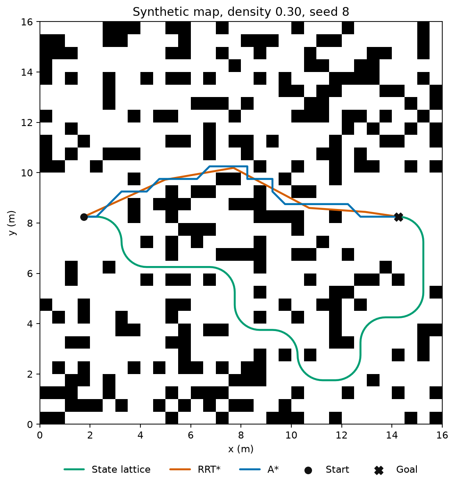
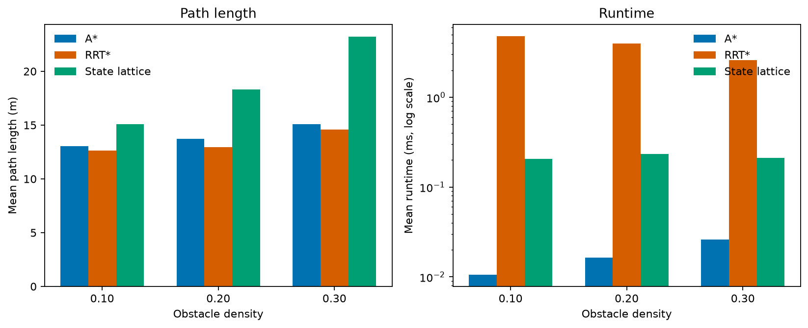
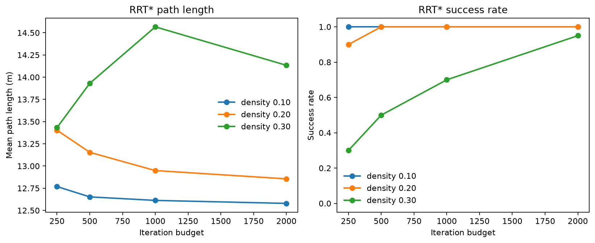

# planbench

A C++17 library for 2D path planning on a shared occupancy grid, with three planners.

A\* runs on an 8-connected grid. Cardinal steps cost one cell width and diagonal steps cost `sqrt(2)` cell widths. A diagonal step is rejected when either adjacent cardinal cell is occupied, so the path cannot clip a corner. The heuristic is the octile distance, which is consistent on this graph, so a path that is found is optimal in grid length.

RRT\* works in continuous coordinates. Samples are uniform inside the map. Each edge is a straight segment and is kept only when it does not touch an occupied cell. Nearby vertices are rewired inside a radius that shrinks as `sqrt(log n / n)`.

The state lattice is for a simple car. The state is a grid cell plus one of four headings (0°, 90°, 180°, 270°). Motion primitives are forward straights and 90° circular arcs at a fixed turning radius. A rectangular body is checked along each primitive. Search is A\* with Euclidean distance as the heuristic, so the result is optimal in arc length over this primitive set. The vehicle starts facing +x.

A\* and RRT\* plan for a point. The lattice plans for a body with a minimum turning radius, so it fails on some maps the point planners still solve, and its paths are longer when they exist.

## Maps are synthetic

All maps in the benchmark, the generator tests and the figures are synthetic. Each cell is occupied independently with a fixed probability, drawn from `std::mt19937` in row-major order. A square Chebyshev window around the start and the goal is then cleared. The same width, height, resolution, probability, seed, and clearance always rebuild the same map.

## Build

You need CMake 3.16 or newer and a C++17 compiler (this tree is built with `g++` 13). The first configure downloads GoogleTest. Figures need Python 3 and matplotlib (`python3 -m pip install -r scripts/requirements.txt`).

```bash
cmake -S . -B build -DCMAKE_BUILD_TYPE=Release -DCMAKE_CXX_COMPILER=g++
cmake --build build -j
ctest --test-dir build --output-on-failure
```

Tests cover A\* optimality on maps with a known length (empty grids, a gapped wall, and a corner that must not be cut), agreement with an independent uniform-cost search, segment and rectangle collision checks, and path validity for all three planners (endpoints, free space, and, for the lattice, the rectangular body).

## Benchmark

From the repository root:

```bash
./build/planbench_benchmark --output docs/benchmark.csv --paths docs/example_paths.csv
python3 scripts/plot_benchmark.py
```

The benchmark binary checks every reported success. A path that leaves free space, breaks the lattice body, or disagrees with its stated length aborts the run.

Default protocol, which produced `docs/benchmark.csv`:

| Setting | Value |
| --- | --- |
| Grid | 32 × 32 cells at 0.5 m (16 m × 16 m) |
| Densities | 0.10, 0.20, 0.30 |
| Seeds | 1 through 20 |
| Clearance | 3 cells around start and goal |
| Start / goal | cell centers (3, 16) and (28, 16) |
| RRT\* step and goal radius | 0.75 m |
| RRT\* goal-sample probability | 0.10 |
| RRT\* summary budget | 1000 iterations |
| RRT\* curve | 250, 500, 1000, 2000 iterations |
| Lattice turning radius | 1.0 m (2 cells after snapping to the grid) |
| Lattice body | 0.45 m long, 0.28 m wide |

RRT\* is seeded with `map_seed + 7919` and records the best path at each budget inside one run, so a larger budget is a continuation of the smaller one. Mean path length averages successful trials only. Mean runtime averages every trial, including failures, and is a wall time in milliseconds. The `summary` rows for RRT\* are the 1000-iteration snapshot, so they match the `rrt_budget` rows at 1000.

CI uses a smaller run that does not overwrite these files:

```bash
./build/planbench_benchmark --small --output /tmp/benchmark_small.csv --paths /tmp/example_paths_small.csv
```

## Results

Runtimes in the tables below were measured on the machine that generated `docs/benchmark.csv` (4-core Intel Xeon, x86_64). They are wall times from that run and will differ on another machine.

Mean path length is in meters. At density 0.30 the RRT\* mean is not monotone in the iteration budget: maps that become solvable only at a higher budget are longer, so the average over successes can rise even while each individual path stays the same or gets shorter.

### Summary

| table | planner | density | iterations | trials | successes | success_rate | mean_path_length_m | mean_runtime_ms |
| --- | --- | --- | --- | --- | --- | --- | --- | --- |
| summary | astar | 0.10 | 0 | 20 | 20 | 1.000000 | 13.061701 | 0.010605 |
| summary | rrt_star | 0.10 | 1000 | 20 | 20 | 1.000000 | 12.613013 | 4.790309 |
| summary | state_lattice | 0.10 | 0 | 20 | 20 | 1.000000 | 15.083407 | 0.205044 |
| summary | astar | 0.20 | 0 | 20 | 20 | 1.000000 | 13.702691 | 0.016365 |
| summary | rrt_star | 0.20 | 1000 | 20 | 20 | 1.000000 | 12.948840 | 3.969646 |
| summary | state_lattice | 0.20 | 0 | 20 | 20 | 1.000000 | 18.317698 | 0.234989 |
| summary | astar | 0.30 | 0 | 20 | 20 | 1.000000 | 15.072971 | 0.025900 |
| summary | rrt_star | 0.30 | 1000 | 20 | 14 | 0.700000 | 14.566367 | 2.608768 |
| summary | state_lattice | 0.30 | 0 | 20 | 1 | 0.050000 | 23.207963 | 0.210646 |

### RRT\* path length and success versus iteration budget

| table | planner | density | iterations | trials | successes | success_rate | mean_path_length_m | mean_runtime_ms |
| --- | --- | --- | --- | --- | --- | --- | --- | --- |
| rrt_budget | rrt_star | 0.10 | 250 | 20 | 20 | 1.000000 | 12.769015 | 0.688533 |
| rrt_budget | rrt_star | 0.10 | 500 | 20 | 20 | 1.000000 | 12.652600 | 1.829638 |
| rrt_budget | rrt_star | 0.10 | 1000 | 20 | 20 | 1.000000 | 12.613013 | 4.790309 |
| rrt_budget | rrt_star | 0.10 | 2000 | 20 | 20 | 1.000000 | 12.579376 | 12.847644 |
| rrt_budget | rrt_star | 0.20 | 250 | 20 | 18 | 0.900000 | 13.403001 | 0.454449 |
| rrt_budget | rrt_star | 0.20 | 500 | 20 | 20 | 1.000000 | 13.154270 | 1.373219 |
| rrt_budget | rrt_star | 0.20 | 1000 | 20 | 20 | 1.000000 | 12.948840 | 3.969646 |
| rrt_budget | rrt_star | 0.20 | 2000 | 20 | 20 | 1.000000 | 12.855628 | 11.509051 |
| rrt_budget | rrt_star | 0.30 | 250 | 20 | 6 | 0.300000 | 13.432170 | 0.229839 |
| rrt_budget | rrt_star | 0.30 | 500 | 20 | 10 | 0.500000 | 13.930844 | 0.767793 |
| rrt_budget | rrt_star | 0.30 | 1000 | 20 | 14 | 0.700000 | 14.566367 | 2.608768 |
| rrt_budget | rrt_star | 0.30 | 2000 | 20 | 19 | 0.950000 | 14.133611 | 8.711954 |

A\* solves every map. Its path length grows from 13.06 m at density 0.10 to 15.07 m at density 0.30, and each search takes under 0.03 ms. RRT\* at 1000 iterations also solves every map at the two lower densities and 14 of 20 at density 0.30. At that density its success rate goes from 0.30 at 250 iterations to 0.95 at 2000. The state lattice solves every map at densities 0.10 and 0.20 but only 1 of 20 at 0.30, with a 23.21 m path, because the body and turning radius no longer fit through most gaps.

## Figures

`scripts/plot_benchmark.py` reads `docs/benchmark.csv` and `docs/example_paths.csv` and writes the PNGs in `docs/`. The overlay is the synthetic map of density 0.30 and seed 8, the seed in this batch where all three planners succeed and the A\* path is longest.







## Layout

```
include/planbench/   public headers
src/                 library and benchmark
tests/               GoogleTest sources
scripts/plot_benchmark.py
docs/                benchmark.csv, example paths, figures
.github/workflows/ci.yml
```

CI builds in Release with `g++`, runs the tests and the small benchmark, and draws the three figures from that small run.
